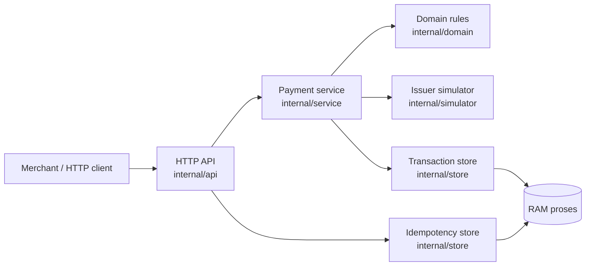
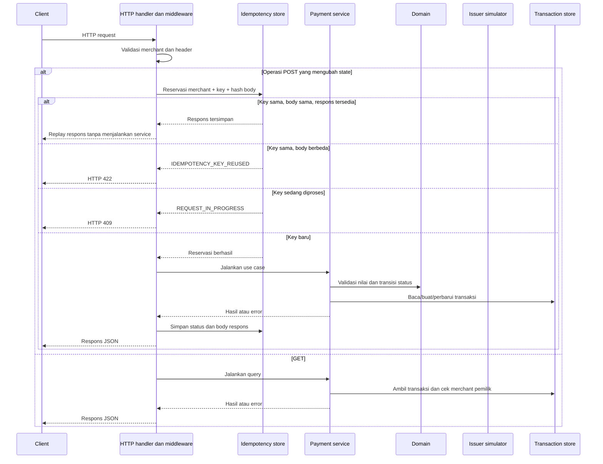
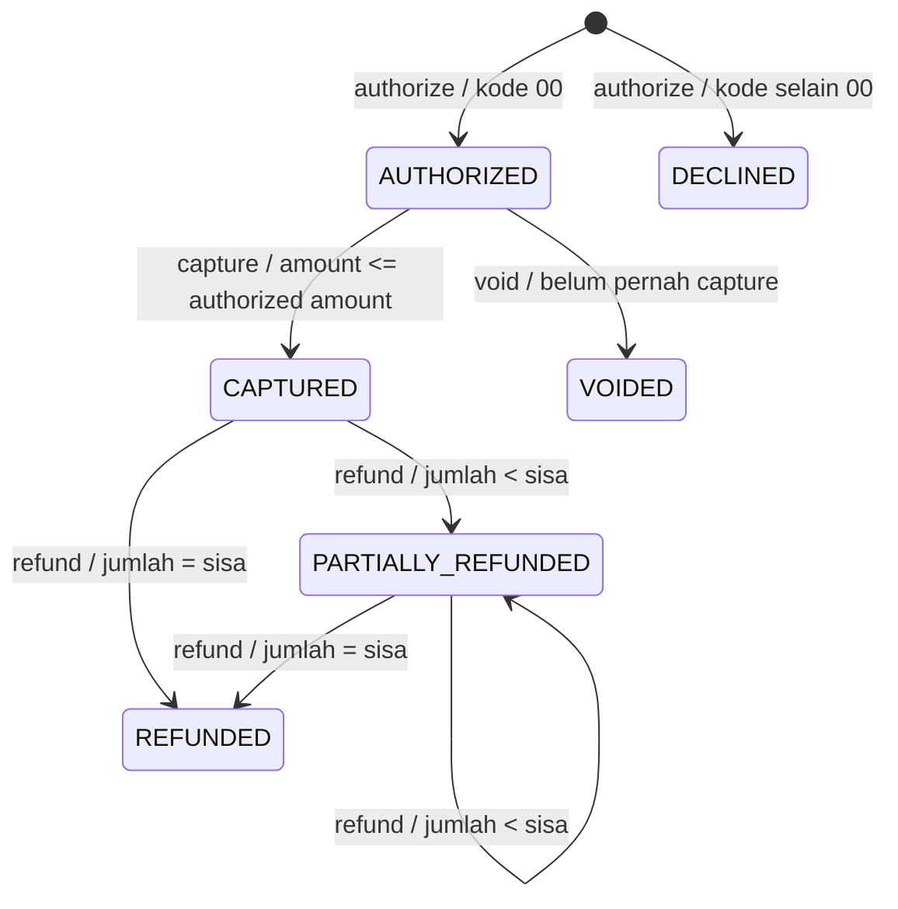

# Flow Aplikasi Payment Processing Simulator

Dokumen ini menjelaskan bagaimana aplikasi bekerja dari server dimulai, HTTP request diterima, logika bisnis dijalankan, hingga respons dikirim. Ini berbeda dari [flow pengujian Postman](./POSTMAN-FLOW.md), yang menjelaskan cara menjalankan request test.

## Gambaran komponen



Server tidak menggunakan database. Transaction store dan idempotency store berada di RAM proses; seluruh isinya hilang ketika server berhenti atau restart.

## 1. Startup server

1. `cmd/server` membaca konfigurasi environment: port, latensi simulator, TTL idempotensi, merchant yang diizinkan, dan level log.
2. Entrypoint membuat in-memory transaction store, in-memory idempotency store, issuer simulator, payment service, dan HTTP handler.
3. `net/http` menjalankan router. `GET /healthz` dipakai untuk memastikan server siap.
4. Saat menerima SIGINT/SIGTERM, server berhenti secara graceful dengan batas waktu shutdown.

## 2. Flow umum request



Middleware autentikasi memeriksa `X-Merchant-ID` terhadap konfigurasi `MERCHANTS`. Operasi `POST` juga mewajibkan `Idempotency-Key`. Logging hanya mencatat metadata request seperti method, path, status, dan durasi; body authorize tidak dicatat.

Untuk setiap operasi POST, key idempotensi berlaku dalam ruang merchant dan menyimpan hash byte body. Retry request identik menerima hasil yang tersimpan. Key yang sama dengan body berbeda ditolak. Record yang kedaluwarsa dibersihkan secara lazy ketika key tersebut dicari kembali.

## 3. Flow authorize

Endpoint:

```text
POST /v1/transactions/authorize
```

1. API membaca JSON berisi amount, currency, dan data kartu sementara.
2. Domain memvalidasi nominal serta mata uang yang didukung (`IDR` atau `USD`); service memvalidasi merchant, PAN, masa berlaku, dan CVV.
3. Kartu kedaluwarsa menghasilkan kode `54`. Jika belum kedaluwarsa, service meminta issuer simulator memeriksa PAN.
4. Simulator menerapkan Luhn dan mencocokkan empat digit akhir dengan kode uji: `0005` → `05`, `0051` → `51`, `0054` → `54`, `0091` → `91`; selain itu → `00`. PAN invalid menghasilkan `14`.
5. Kode `00` membuat status `AUTHORIZED`; kode lainnya membuat status `DECLINED`.
6. Store menyimpan transaksi berisi ID, nominal, status, kode respons, merchant, dan metadata kartu saja: brand, empat digit terakhir, serta expiry. PAN penuh dan CVV tidak disimpan.
7. API mengembalikan transaksi JSON dengan HTTP `201`.

Respons `91` disimpan sebagai `DECLINED`. Untuk mencoba lagi sebagai transaksi baru, kirim operasi authorize baru dengan idempotency key baru.

## 4. Flow perubahan transaksi



- **Capture** hanya dapat dilakukan dari `AUTHORIZED`, dengan nominal positif yang tidak melebihi nilai authorization. Capture parsial mengubah `CapturedAmount` menjadi nominal capture yang diminta.
- **Void** hanya dapat dilakukan dari `AUTHORIZED`. Transaksi yang telah di-capture tidak dapat di-void.
- **Refund** hanya dapat dilakukan dari `CAPTURED` atau `PARTIALLY_REFUNDED`. Total refund tidak boleh melampaui `CapturedAmount`; setiap refund menambah `RefundedAmount`.
- Update memakai `Version` untuk optimistic locking. Jika transaksi telah berubah sejak dibaca, update ditolak sebagai konflik.
- Transisi tidak valid menghasilkan error domain yang dipetakan API ke HTTP `409`.

Semua operasi perubahan memerlukan idempotency key dan menghasilkan respons JSON. Capture, void, dan refund sukses mengembalikan HTTP `200`.

## 5. Flow GET transaksi

Endpoint:

```text
GET /v1/transactions/{id}
```

Service mengambil transaksi berdasarkan ID dan membandingkan `MerchantID` transaksi dengan `X-Merchant-ID` peminta. Merchant lain tidak dapat membaca transaksi. Hasilnya HTTP `200`; ID tidak ada dipetakan ke `404`, dan merchant yang tidak memiliki transaksi dipetakan ke `403`.

## 6. Pemetaan kode sumber

| Area | Lokasi | Tanggung jawab |
|---|---|---|
| Startup dan shutdown | [`cmd/server/main.go`](./cmd/server/main.go) | Wiring dependency, konfigurasi, HTTP server, graceful shutdown |
| Router, handler, middleware | [`internal/api/handler.go`](./internal/api/handler.go) | HTTP/JSON, merchant validation, idempotensi, logging, pemetaan error |
| Entitas dan aturan domain | [`internal/domain/`](./internal/domain) | Money, card validation/masking, transaksi, state machine |
| Use case | [`internal/service/service.go`](./internal/service/service.go) | Authorize, capture, void, refund, get dan ownership |
| Implementasi penyimpanan | [`internal/store/`](./internal/store) | In-memory transaction dan idempotency store |
| Keputusan issuer | [`internal/simulator/issuer.go`](./internal/simulator/issuer.go) | Kode respons deterministik dan latensi simulasi |
| Environment config | [`internal/config/config.go`](./internal/config/config.go) | Membaca dan memvalidasi konfigurasi environment |

## 7. Batas simulator

- Hanya untuk edukasi dan pengujian lokal; tidak menghubungi payment network sungguhan.
- Pakai nomor kartu uji; jangan pernah memasukkan PAN/CVV asli.
- Transaksi dan idempotensi hanya bertahan selama proses server hidup.
- Autentikasi merchant melalui `X-Merchant-ID` dan `MERCHANTS` adalah mekanisme simulasi, bukan autentikasi production.
