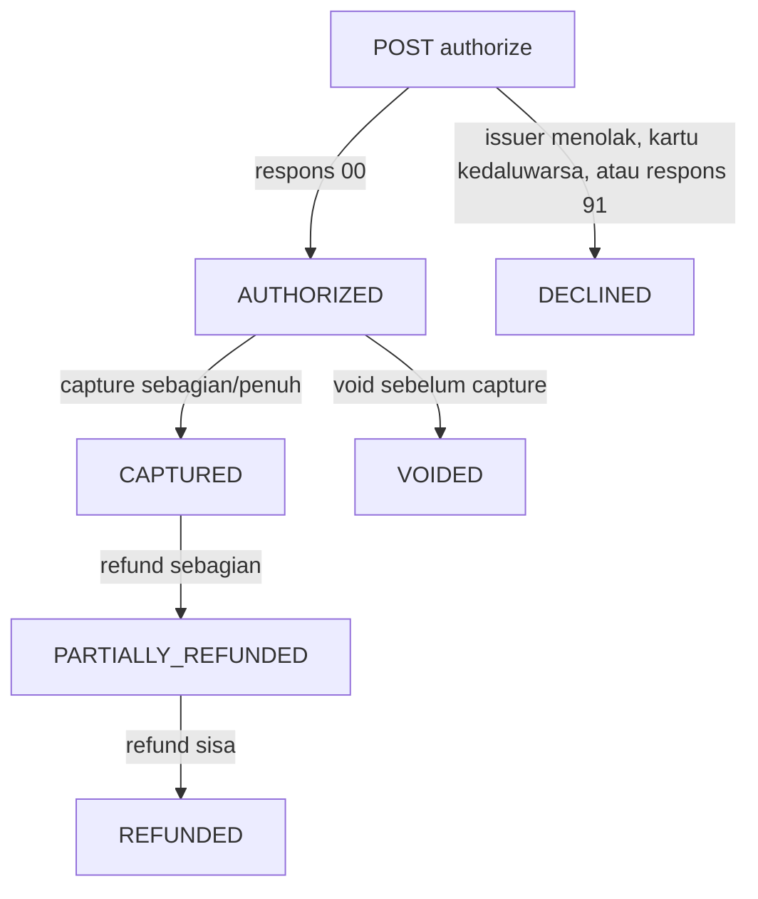

# Flow Pengujian Postman

Dokumen ini menjelaskan cara menjalankan koleksi Postman, perubahan status transaksi, dan cara menangani error `IDEMPOTENCY_KEY_REUSED`.

## 1. Persiapan

1. Jalankan server dari root project:

   ```sh
   make run
   ```

2. Pastikan server tersedia di `http://localhost:8080`. Ubah collection variable `baseUrl` jika menggunakan port lain.
3. Import [`payment-simulator.postman_collection.json`](./payment-simulator.postman_collection.json).
4. Gunakan `merchant_demo` pada collection variable `merchantId`, kecuali server dijalankan dengan konfigurasi `MERCHANTS` berbeda.
5. Untuk test yang berhasil di-approve, gunakan kartu uji Luhn-valid dan tanggal kedaluwarsa yang masih berlaku.

Koleksi menggunakan collection variables untuk menyimpan ID transaksi hasil authorize. Jalankan request secara berurutan menggunakan **Collection Runner**, atau klik satu per satu sesuai nomor.

## 2. Urutan koleksi

| No. | Request | Hasil yang diharapkan |
|---|---|---|
| 1 | Health check | HTTP `200`, `status: ok` |
| 2 | Authorize approved card | HTTP `201`, status `AUTHORIZED`; ID transaksi disimpan otomatis |
| 3 | Retry authorize dengan body dan key yang sama | HTTP `201`; ID sama dengan transaksi pada request 2 |
| 4 | Pakai key authorize yang sama dengan body berbeda | HTTP `422`, kode `IDEMPOTENCY_KEY_REUSED` (hasil yang diharapkan untuk test negatif ini) |
| 5 | Capture IDR 75.000 | HTTP `200`, status `CAPTURED` |
| 6 | Refund IDR 25.000 | HTTP `200`, status `PARTIALLY_REFUNDED` |
| 7 | Refund sisa IDR 50.000 | HTTP `200`, status `REFUNDED` |
| 8 | Authorize transaksi baru untuk test void | HTTP `201`, ID void disimpan otomatis |
| 9 | Void transaksi kedua | HTTP `200`, status `VOIDED` |
| 10 | Ambil detail transaksi pertama | HTTP `200`, status `REFUNDED` |

Flow statusnya:



`DECLINED`, `REFUNDED`, dan `VOIDED` adalah hasil akhir untuk flow yang ditampilkan. Misalnya, transaksi yang sudah di-void tidak bisa di-capture.

## 3. Kenapa mengganti nomor kartu menghasilkan 422?

Setiap `POST` memerlukan header `Idempotency-Key`. Server mengaitkan key dengan merchant dan hash body request:

```text
merchant_demo + Idempotency-Key + SHA-256(body)
```

Jika key yang sudah pernah dipakai dikirim lagi dengan body yang sama, server mengembalikan respons tersimpan. Ini adalah **retry aman** dan tidak membuat transaksi baru.

Hash dibuat dari byte body yang dikirim. Karena itu, perubahan nomor kartu, nominal, atau isi/format body berarti request berbeda. Jika body berbeda, server tidak mengeksekusi request dan merespons:

```json
{
  "error": {
    "code": "IDEMPOTENCY_KEY_REUSED",
    "message": "key was already used with a different request"
  }
}
```

Mengubah nomor kartu berarti body berubah. Karena itu, `422` yang terlihat di Postman adalah proteksi idempotensi yang berfungsi sesuai desain, bukan indikasi nomor kartu pengganti pasti ditolak.

### Mencoba nomor kartu berbeda dengan transaksi baru

1. Untuk satu rangkaian testing baru, buat key unik untuk authorize, capture, kedua refund, authorize-void, dan void (contoh `authorize-card-2`, `capture-card-2`, `refund-card-2a`, `refund-card-2b`, `authorize-void-2`, `void-card-2`).
2. Isi key tersebut pada collection variables `authorizeKey`, `captureKey`, `refundPartialKey`, `refundRemainingKey`, `voidAuthorizeKey`, dan `voidKey`.
3. Ubah field `card.number` pada request **2. Authorize approved card**.
4. Ubah body request **3. Retry authorize (same key and body)** dengan perubahan yang sama persis, supaya request ini benar-benar menguji retry.
5. Biarkan request **4. Reuse authorize key with different body** menggunakan key authorize yang sama dan body berbeda dari request 2/3. Request 4 memang diharapkan membalas `422`.
6. Jalankan kembali. Response authorize yang baru akan menyimpan ID baru pada collection variable `transactionId`.

Semua key harus baru untuk siklus transaksi baru, bukan hanya `authorizeKey`. Server mengikat key ke merchant (key yang sama tetap bertabrakan meskipun dipakai di endpoint capture/refund/void yang berbeda). Jika key operasi capture/refund/void lama dipakai untuk transaksi baru, server dapat memutar ulang respons operasi lama. Gunakan key yang sama hanya untuk retry operasi yang sama dengan body identik. Key juga harus unik untuk setiap merchant.

## 4. Kartu uji

Gunakan hanya kartu uji berikut. Semua nomor di tabel lolos Luhn dan memicu hasil deterministik di simulator:

| Nomor | Kode respons | Hasil authorize |
|---|---|---|
| `4111111111111111` | `00` | `AUTHORIZED` |
| `4111111111120005` | `05` | `DECLINED` |
| `4111111111150051` | `51` | `DECLINED` |
| `4111111111120054` | `54` | `DECLINED` |
| `4111111111170091` | `91` | `DECLINED`; untuk percobaan ulang buat transaksi dan idempotency key baru |

Untuk test 422, jangan mengubah value collection variable pada request khusus **4. Reuse authorize key with different body**: request tersebut sengaja memakai key yang sama dengan request authorize tetapi body-nya berbeda.

Jika menjalankan seluruh koleksi lagi, perbarui semua enam collection variables key di atas sebelum mengirim operasi transaksi yang baru. Request nomor 3 dan 4 tetap harus menggunakan `authorizeKey` yang sama untuk menguji replay dan penolakan body berbeda.

## 5. Batas penyimpanan

Transaksi dan catatan idempotensi disimpan in-memory, bukan di database. Data tersebut hilang ketika server dihentikan atau direstart. Gunakan server yang sama selama satu sesi Collection Runner; setelah restart, test dimulai dari state kosong.

PAN dan CVV hanya dipakai sementara untuk validasi dan simulasi. Respons transaksi menyimpan metadata kartu saja, termasuk empat digit terakhir; jangan memasukkan data kartu asli.
